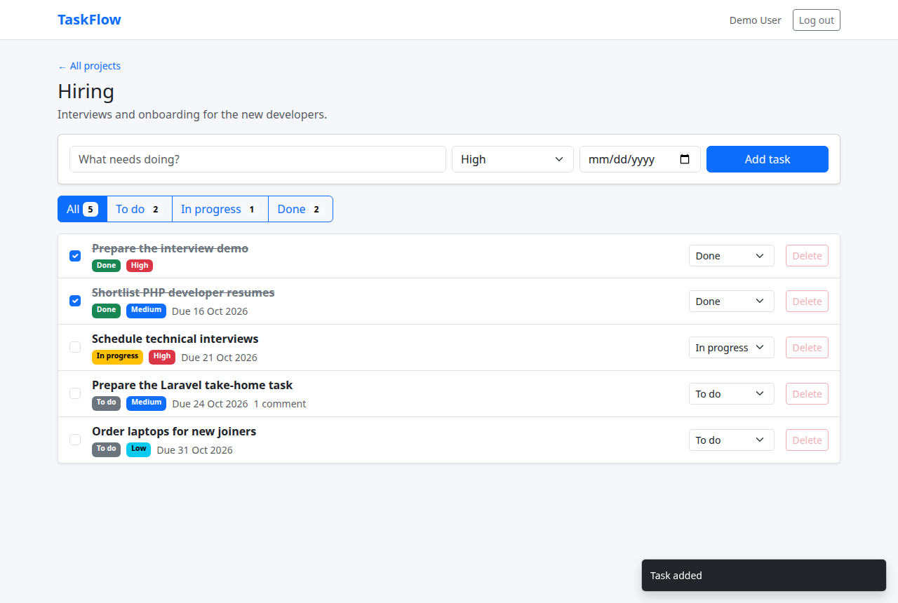
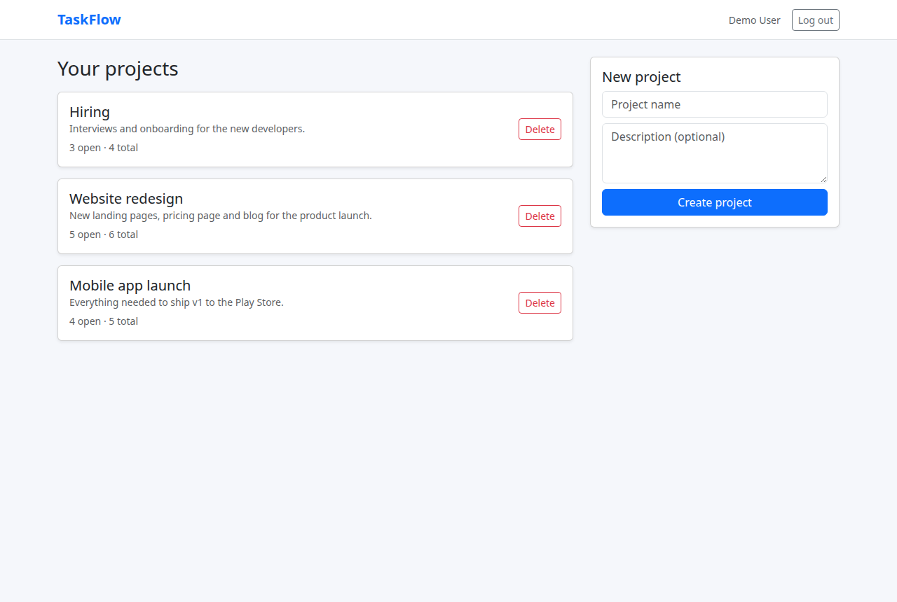

# TaskFlow

A task management app built with **Laravel 13**: a jQuery + Bootstrap dashboard that updates without page reloads, and a versioned **REST API** with Sanctum token authentication. Projects hold tasks, tasks have a status, priority, due date and comments, and the app emails owners about tasks due within a day.



| Projects | |
|---|---|
|  | Every list is scoped to the logged-in user, with open/total task counts per project. |

## What's inside

| Feature | How it's built |
|---|---|
| **Dashboard without reloads** | jQuery AJAX for add / tick / change status / delete, with the CSRF token sent on every request and event delegation for rows added later. The server answers with the row rendered by the same Blade component the page uses, so there's one template, not two. |
| **REST API, versioned** | `/api/v1/...` with `Route::apiResource` (shallow nested `projects.tasks`), API Resources for the JSON shape, pagination with `links`/`meta`. |
| **Token authentication** | Laravel Sanctum: register, login (returns a token), logout revokes only the current token. The web dashboard uses normal session login. |
| **Authorization** | Policies (`ProjectPolicy`, `TaskPolicy`): you can only see or change your own projects and their tasks, otherwise `403`. |
| **Validation** | Form Requests for every write, enum validation with `Rule::enum`, errors as `422` JSON for AJAX/API and inline messages for forms. |
| **Filtering, search, sorting** | `?status=done&priority=high&search=login&sort=-due_at&per_page=20`, built as Eloquent scopes with a whitelist of sortable columns. |
| **PHP 8.1 enums** | `TaskStatus` and `TaskPriority` backed enums, cast on the model, with labels and badge colours. |
| **Deadline reminders** | `php artisan tasks:remind` (scheduled hourly) finds open tasks due within 24 h, sends a queued `TaskDueSoon` notification by **mail and database**, and marks the task so nobody is reminded twice. |
| **Rate limiting** | 60 API requests / minute per user, 5 login attempts / minute per email + IP. |
| **No N+1 queries** | Eager loading and `withCount` everywhere; `Model::preventLazyLoading()` makes any lazy load throw outside production. |
| **Tests** | 38 PHPUnit feature tests: auth, CRUD, validation, filtering, pagination, authorization (403s), the AJAX endpoints, XSS escaping and the reminder command. CI runs them plus Laravel Pint on every push. |
| **Docker** | `docker compose up` starts PHP 8.4, MySQL 8.4, a queue worker and the scheduler. |

## Run it

You only need Docker.

```bash
git clone https://github.com/amanjhacodes55/taskflow.git && cd taskflow
cp .env.example .env
docker compose run --rm app composer install
docker compose run --rm app php artisan key:generate
docker compose up -d
docker compose exec app php artisan db:seed      # demo data
```

Open **http://localhost:8000** and log in as `demo@taskflow.test` / `password`.

Emails (the reminders) are written to `storage/logs/laravel.log` in development. Trigger them by hand with `docker compose exec app php artisan tasks:remind`.

## API

All routes are under `/api/v1`. Send `Accept: application/json`, and `Authorization: Bearer <token>` for everything except register and login.

| Method | Endpoint | |
|---|---|---|
| POST | `/auth/register` | name, email, password, password_confirmation → `{user, token}` |
| POST | `/auth/login` | email, password, device_name? → `{user, token}` |
| GET | `/auth/me` | the current user |
| POST | `/auth/logout` | revokes the current token |
| GET, POST | `/projects` | list (with task counts) / create |
| GET, PATCH, DELETE | `/projects/{id}` | |
| GET, POST | `/projects/{id}/tasks` | list with `status`, `priority`, `search`, `sort`, `per_page` / create |
| GET, PATCH, DELETE | `/tasks/{id}` | a task with its comments |
| GET, POST | `/tasks/{id}/comments` | |

```bash
TOKEN=$(curl -s -X POST localhost:8000/api/v1/auth/login -H 'Accept: application/json' \
  -d 'email=demo@taskflow.test&password=password' | jq -r .token)

curl -s "localhost:8000/api/v1/projects/1/tasks?status=todo&sort=due_at" \
  -H 'Accept: application/json' -H "Authorization: Bearer $TOKEN" | jq
```

## Tests

```bash
docker compose run --rm app php artisan test
```

## Where things are

```
app/Enums/                 TaskStatus, TaskPriority
app/Models/                Project, Task (scopes: filter, sortBy, dueSoon), Comment, User
app/Policies/              who may see and change what
app/Http/Requests/         validation for every write
app/Http/Resources/        the API's JSON shape
app/Http/Controllers/Api/V1/   REST API
app/Http/Controllers/Web/      dashboard pages + the JSON endpoints its jQuery calls
app/Notifications/         TaskDueSoon (mail + database, queued)
app/Console/Commands/      tasks:remind
resources/views/components/    task-row, alert (Blade components)
public/js/tasks.js         the dashboard's jQuery
routes/console.php         the schedule
tests/Feature/             API, web and reminder tests
```
